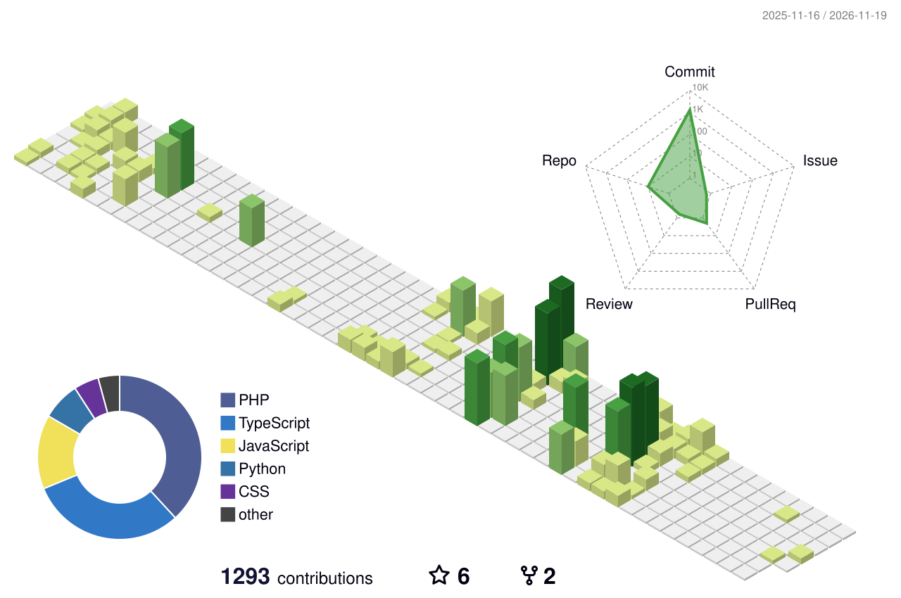

<!-- Luthfi Fauzi · GitHub profile — matches luthfafi.my.id (ink, white, accent #F26B1D, planet blue #2F6FE0) -->

<div align="center">

<a href="https://luthfafi.my.id">
  
</a>

<br/>

<a href="https://luthfafi.my.id">
  
</a>

<br/><br/>

<a href="https://luthfafi.my.id"></a>
<a href="https://www.linkedin.com/in/luthfafi"></a>
<a href="mailto:luthfafipro@gmail.com"></a>
<a href="https://www.instagram.com/luthfafi"></a>

</div>

<br/>

## About

I build practical software — business systems, product platforms and applied AI — from the database to the screen people actually use. Most of my work lives where operations meet code: attendance and payroll, point-of-sale, job search, and the websites that explain all of it.

```ts
const luthfi = {
  role: "Full-Stack Software Engineer",
  base: "Bandung, Indonesia",
  focus: ["Business systems", "Product platforms", "Applied AI/ML"],
  education: "B.Sc. Informatics — Telkom University (2021–2025)",
  research: "IEEE SOFTT 2025 — first author",
  portfolio: "https://luthfafi.my.id",
};
```

## Selected Work

<table>
  <tr>
    <td width="50%" valign="top">
      <a href="https://luthfafi.my.id/work/trakerja"></a>
      <h3><a href="https://luthfafi.my.id/work/trakerja">TraKerja</a></h3>
      Job search &amp; tracking platform for Indonesian job seekers — openings from 10+ sources, deduplicated and status-checked, with AI CV review.
      <br/><br/>
      <code>Laravel</code> <code>PHP</code> <code>OpenAI API</code> · <b>1,000+ users</b>
    </td>
    <td width="50%" valign="top">
      <a href="https://luthfafi.my.id/work/pos-business-management"></a>
      <h3><a href="https://luthfafi.my.id/work/pos-business-management">POS &amp; Business Management</a></h3>
      Multi-outlet point of sale with offline-first transactions, server sync, QRIS and bank EDC payments.
      <br/><br/>
      <code>Flutter</code> <code>Go</code>
    </td>
  </tr>
  <tr>
    <td width="50%" valign="top">
      <a href="https://luthfafi.my.id/work/hris-platform"></a>
      <h3><a href="https://luthfafi.my.id/work/hris-platform">HRIS Platform</a></h3>
      GPS-geofenced attendance, leave &amp; overtime approvals, and payroll with BPJS and PPh 21.
      <br/><br/>
      <code>Laravel</code> <code>PHP</code>
    </td>
    <td width="50%" valign="top">
      <a href="https://luthfafi.my.id/work/kelola-aja"></a>
      <h3><a href="https://luthfafi.my.id/work/kelola-aja">KelolaAja</a> · <a href="https://luthfafi.my.id/work/nikawa-teknika">Nikawa Teknika</a></h3>
      Bilingual marketing sites for a business control system and an industrial distributor.
      <br/><br/>
      <code>Next.js</code> <code>React</code> <code>Tailwind CSS</code>
    </td>
  </tr>
</table>

<p align="center"><a href="https://luthfafi.my.id/#work"><b>See every project with screenshots →</b></a></p>

## Toolkit

<p align="center">
  <picture>
    <source media="(prefers-color-scheme: dark)" srcset="https://skillicons.dev/icons?i=php%2Cjs%2Cts%2Cgo%2Cpy%2Claravel%2Creact%2Cnextjs%2Cflutter%2Ctailwind%2Cmysql%2Ctensorflow%2Cdocker%2Cgitlab%2Clinux%2Cnginx%2Cgit%2Cvercel&perline=9&theme=dark" />
    
  </picture>
</p>

## Experience

| When | Role | Where |
| :-- | :-- | :-- |
| Apr – Oct 2026 | **Software Engineer** (project based) | PT Teknologi Transformasi Digital |
| Nov 2025 – Apr 2026 | **Software Engineer Intern** | Ministry of Finance of the Republic of Indonesia · DJSPSK |
| Jan – Jul 2025 | **AI/ML Trainee** | DBS Foundation Coding Camp |
| Jul – Sep 2024 | **Web Developer Intern** | Telkom Metra |

## Research

**Hybrid CNN–BiLSTM model for multimodal sentiment analysis** — first author, IEEE SOFTT 2025
<br/>
<a href="https://doi.org/10.1109/SOFTT67007.2025.11212985"></a>

## Activity

<div align="center">

<picture>
  <source media="(prefers-color-scheme: dark)" srcset="https://raw.githubusercontent.com/mocitaz/mocitaz/main/profile-3d-contrib/profile-night-green.svg" />
  
</picture>


</div>

<br/>

<div align="center">
  
  <br/>
  
  <br/>
  <sub>Luthfi Fauzi · Bandung, Indonesia · <a href="https://luthfafi.my.id">luthfafi.my.id</a></sub>
</div>
